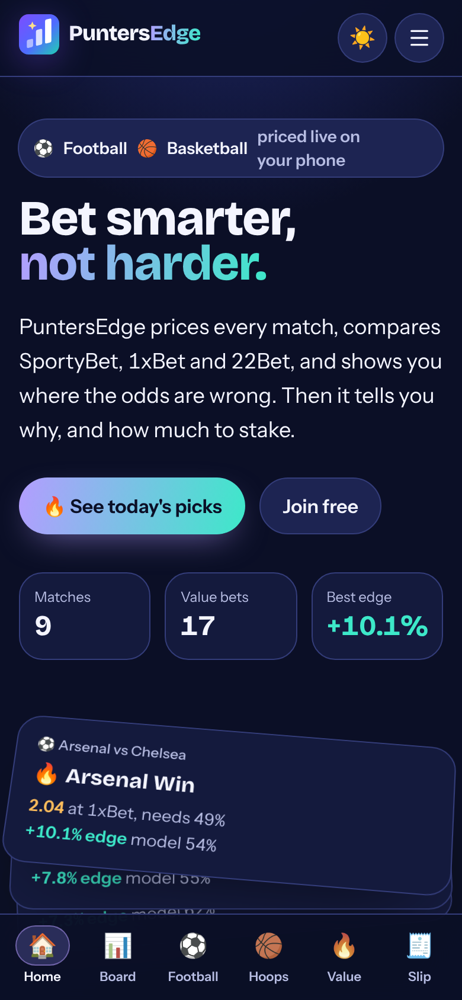

# PuntersEdge

Model upgrade: [evidence-gated integration](docs/MODEL-UPGRADE.md) and [real-data results](docs/TRAINING-RESULTS.md). Fitted candidates remain in shadow evaluation; no bookmaker advantage or guaranteed strike-rate improvement is claimed.

Live fixtures, fair prices, value bets and stake sizes for **football, NBA, basketball, ice hockey and baseball** — an installable, offline-capable PWA that prices every game on-device and checks the result against SportyBet, 1xBet, 22Bet and more.



## What it does

- **Prices every market from first principles, per sport.** Football: Dixon–Coles (absences priced in). NBA and basketball: tempo-free pace × efficiency, priced analytically for any line. Ice hockey: Poisson goals with overtime/shootout resolution. Baseball: negative-binomial runs with extra innings.
- **Live data on a budget.** A Convex cron pulls fixtures, live scores, results, league tables and bookmaker prices from API-Sports, The Odds API and OddsPapi, rationed within safe daily/monthly budgets; provider plans can still limit freshness and coverage.
- **Honest track record.** Each game's best graded pick is recorded before kickoff and settled from the final score on the Results page.
- **Removes the bookmaker's margin** with Shin's method and blends the model with the de-vigged market consensus (default 60/40, adjustable).
- **Scans every market at every book** for prices above fair value, then sizes stakes with fractional Kelly on your bankroll.
- **Explains itself.** Four deterministic agents (market, squad, quant, risk) reason over the numbers and either recommend a bet or say *pass* — the app never invents an edge.
- **Every market behind the +.** Tapping + on a pick adds it and opens every other market on that match: double chance, draw no bet, Asian handicaps, goal and point ladders, BTTS, team goals and clean sheets, each priced at every bookmaker.
- **Explains every pick.** Each fixture has a "Why this pick?" panel: what the price needs to win vs the model vs the market, and the drivers behind it.
- **Shows the distribution.** The board's hero is a live 3D surface of the featured match's scoreline probabilities; basketball matches get a Pace lab that re-prices the game as you move sliders.

## Stack

| Layer | Choice |
| --- | --- |
| App | SvelteKit 3, Svelte 5 runes, TypeScript |
| Styling | Tailwind CSS 4 tokens, self-hosted Bricolage Grotesque + Instrument Sans |
| 3D | Three.js (lazy-loaded) |
| Engine | Dependency-free ES modules in `src/lib/engine` (runs in browser and Node) |
| Hosting | Cloudflare Pages: static application page shells; protected APIs use Functions |
| Backend | Convex (`convex/`): auth, betslip sync, live-data ingest (cron + Node action + file storage) |

## Getting started

```bash
npm ci --legacy-peer-deps  # Node 24
npm run dev        # http://localhost:5173
npm test           # engine test suite (node:test)
npm run test:backend # Convex/Better Auth access, billing and webhook tests
npm run check:backend # backend TypeScript
npm run check      # svelte-check / TypeScript
npm run pipeline   # run the engine over the sample feed in the terminal
npm run build      # production build → .svelte-kit/cloudflare
npm run preview    # serve the production build with Wrangler on :4173
npm run build:single  # one self-contained HTML demo → dist-preview/index.html
```

## Backend integration and deployment

The application now uses server-rendered Svelte pages, realtime authenticated Convex feed subscriptions, Better Auth cookie sessions and Resend verification/password recovery. All-access membership costs **₦10,000 per calendar month**, with manual renewals through Flutterwave v4 bank transfer or optional hosted checkout providers. Webhooks verify payment details with the provider before access is granted; duplicate callbacks cannot grant extra months. The administrator is bound to an immutable verified user ID. The branded console has performance/calibration charts, sport/grade/market/probability-band/model-version breakdowns, separate final-verdict stats, private source quotas and audited membership controls.

Members can opt in to background Web Push result alerts after VAPID configuration; foreground device alerts remain available where supported.

The application lives at **puntersedge.ewinproject.org**, under the **ewinproject.org** mother ecosystem. Resend uses the mother domain with sender **PuntersEdge <puntersedge@ewinproject.org>**. Browser bundles contain public endpoint URLs only.

Read [docs/INTEGRATION.md](docs/INTEGRATION.md) for every environment variable, webhook URL, deployment workflow and known external blocker. Read [docs/AUTHENTICATION.md](docs/AUTHENTICATION.md) for secure administrator setup and legacy-account migration, and [docs/SEO.md](docs/SEO.md) for crawl/metadata publication checks. Production workflows are in `.github/workflows/convex-deploy.yml` and `pages-deploy.yml`; hosted configuration helpers never include credential literals.

Backend AI explanations use Agnes with an explicitly configured model or AIHubMix catalog models marked `:free` or the verified `xiaomi-mimo-v2.6-pro-free` alias, with no automatic paid fallback. Only subscribed members may request them. The backend obtains fixture context itself and limits attempts to 10 per member per UTC day, caching a bounded result. Missing provider configuration leaves deterministic analysis available on sample data.

Convex and Pages are deployed at the production domain. Real fixture ingestion, both AI completions and owner verification email delivery have been confirmed. All 108 automated tests pass. Payment settlement and production device-push delivery remain unverified; GitHub source/workflow publication requires write access. See the integration guide for exact hosted status.

## Live data setup

The backend fetches live data only when its provider keys are set. Add them as **Convex environment variables** (Convex dashboard → your production deployment → Settings → Environment variables), or as GitHub secrets with the same names and let the deploy workflow copy them:

| Variable | Provider | Quota and how it's rationed |
| --- | --- | --- |
| `API_SPORTS_KEY` | [API-Sports](https://api-sports.io) (football, basketball, NBA, hockey, baseball) | 100 requests/day per sport API → at most 90, schedule refreshes protected first |
| `THE_ODDS_API_KEY` | [The Odds API](https://the-odds-api.com) | 500 credits/month → at most 488, equal share per remaining day |
| `ODDSPAPI_KEY` | [OddsPapi](https://oddspapi.io) (SportyBet, 1xBet, 22Bet) | 250 requests/month → at most 240, equal share per remaining day |

`API_FOOTBALL_KEY` is accepted as an alias for `API_SPORTS_KEY`. Keys are never committed. After deploying, the cron runs every 30 minutes; to run a tick immediately: `npx convex run ingest:tick` (with `CONVEX_DEPLOY_KEY` set). Quota usage and the source log are on the app's **Results → Data & quotas** panel.

Bookmaker and livescore websites (SportyBet, 1xBet, 22Bet, RedScore, 24live) are not scraped: their terms forbid it and they block automated traffic. The APIs above carry the same bookmakers' prices.

## Accounts

Email/password signup, verified sign-in, logout and recovery use the official [Convex Better Auth component](https://labs.convex.dev/better-auth) (`convex/auth.ts`). The Svelte client uses HttpOnly cookie sessions through the same-origin `/api/auth/*` proxy and obtains short-lived JWTs for authenticated realtime queries. Signed-in users' betslips and analysis settings synchronize to their immutable Convex user profile.

Without an available entitled provider feed, dashboards remain empty and show an explicit unavailable state. Production signup never emulates successful authentication locally.

## Progressive Web App

- `static/manifest.webmanifest` — id, shortcuts, maskable icons at true sizes, narrow/wide screenshots for the rich install sheet.
- `src/service-worker/` — precaches build assets and public home/board shells; private pages and APIs are excluded from shared caching. Failed public navigation can use its cached shell; updates wait for **Update**.
- `src/lib/pwa.svelte.ts` — install prompt (Android/desktop), iOS add-to-home-screen guidance, update and offline state.

## Project layout

```
src/
  lib/
    engine/          maths: football, basketball, hockey & baseball (score_sports), ratings,
                     settlement, vig removal, decisions, market book, pipeline, agents
    feeds/           provider connectors, quota budgets, job planner, team matching,
                     ingest store and feed builder (run inside Convex)
    sports.ts        the five sports: labels, routes, engines
    feed.svelte.ts   live feed loader (cached, offline-friendly)
    glossary.ts      plain-language terms and grade thresholds
    data/fixtures.js sample feed — raw ratings, absences and prices only
    state.svelte.ts  app state; predictions derived from the engine
    components/      SportDashboard, ScoreSurface3D, FixtureCard, PickTicket, SlipSheet, PaceLab, …
  routes/            home, board, sports, football, nba, basketball, hockey, baseball,
                     value-bets, results, bookmakers, glossary, settings, match, login, signup, account
  service-worker/    offline support
convex/              schema, Convex Auth, users, betslip sync, ingest (cron), feed
scripts/pipeline.js  CLI over the sample feed
test/                engine and feed tests (incl. a simulated month against every quota)
```

See [docs/ARCHITECTURE.md](docs/ARCHITECTURE.md) for how a prediction is built.

## Market book

Bookmakers in the feed quote headline markets (1X2, total 2.5, BTTS; moneyline, main spread and total). Their other markets are derived the way books build them: football inverts each book's de-vigged headline prices into that book's own Dixon–Coles model; basketball infers each book's implied margin and total from its main lines. The book's own margin is then applied. Quoted prices are used as quoted, derived ones are labelled, and edges on handicaps and draw-no-bet account for refunds.

## Data

With the provider keys set, the app runs on the **live feed** published by Convex (see Live data setup). Without an available entitled provider feed, dashboards remain empty. Generated sample fixtures are never substituted into production boards. The feed holds inputs only: probabilities, prices, edges and stakes are computed on the device.

## Responsible use

PuntersEdge doesn't place bets. Positive expected value is a long-run property; individual bets lose often. Bet only what you can afford to lose.

## License

MIT

Published pre-match inputs and every market are archived for reproducible model evaluation. Finished analysis remains accessible for 12 hours after its final result is received. Saved slip history retains scores, preserves completed selections while allowing edits to unfinished legs and supports local PDF/WhatsApp exports. See [docs/BETSLIPS.md](docs/BETSLIPS.md).

The advanced bet machine lives at `/bet-machine`. Premium file downloads and saved slips require an active subscription (super-admin bypass). Flutterwave is the sole active gateway; see the integration guide for coverage limits, grading semantics and payment validation status.


Free visitors see the landing page and a limited board of real fixtures. Fixture clicks display a closable VIP invitation; full analysis and all analytical tools require Exclusive VIP (₦10,000/month), with super-admin-only console access. The bet machine chooses its own ticket size within the requested combined-odds range and shows every qualifying option. Notifications are opt-in per device, with category preferences saved in Settings. See the integration guide for preview sanitization, route enforcement, notification delivery and device-testing limitations.

See [multi-market and period backtests](docs/MARKET-BACKTESTS.md) for totals, team totals and handicap evaluations.
